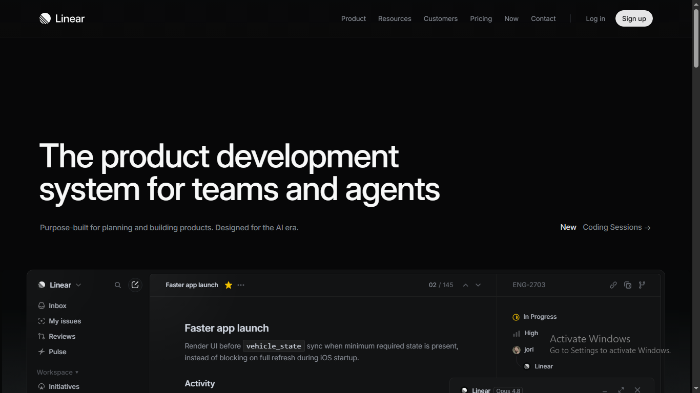

# Linear-Inspired SaaS Website UI

An independent frontend recreation inspired by Linear's modern website design.

## Overview

This project explores a clean, dark SaaS website experience with a focus on typography, layout, navigation, and visual consistency.

## Built With

- HTML5
- CSS3
- Google Fonts

## Features

- Dark visual theme
- Structured navigation
- Hero section
- Product-focused content
- Customer/brand presentation
- Carefully styled typography and layouts

## Project Purpose

Created as an independent practice project to develop my frontend implementation and website UI skills.

## Screenshots

## Live Demo

https://shezan-ali.github.io/linear-ui-clone/

## Disclaimer

This is an independent practice project and is not affiliated with or endorsed by Linear.
