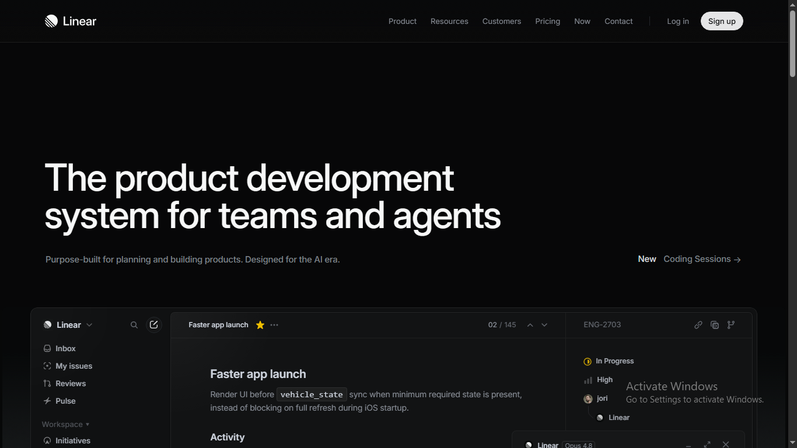
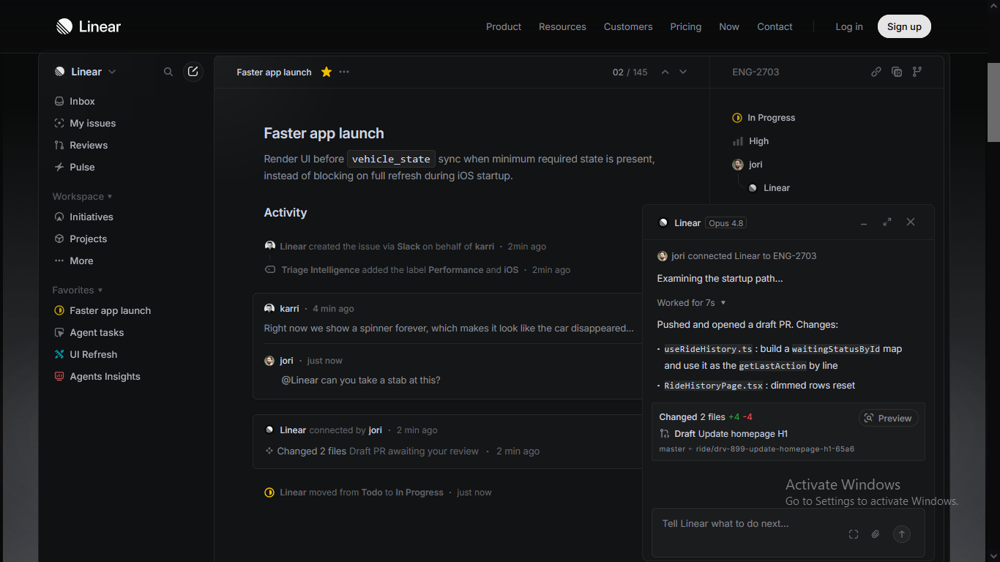

# Linear-Inspired SaaS Website UI

An independent frontend recreation inspired by Linear's modern website design and visual identity.

## Overview

This project recreates a modern SaaS website experience with a dark visual theme, clean typography, structured layouts, and product-focused content.

## Project Status

Completed — Portfolio practice project.

## Built With

- HTML5
- CSS3
- Google Fonts

## Features

- Dark visual theme
- Structured navigation
- Hero section
- Product-focused content
- Customer and brand presentation
- Carefully styled typography and layouts

## Screenshots

## Live Demo

[View Live Website](https://shezan-ali.github.io/linear-ui-clone/)

## What This Project Demonstrates

- Creating clean and modern SaaS website interfaces.
- Using typography, spacing, and visual hierarchy effectively.
- Structuring website sections with HTML.
- Implementing consistent visual styling with CSS.
- Translating a visual reference into a polished website interface.

## Disclaimer

This is an independent practice project and is not affiliated with or endorsed by Linear.
